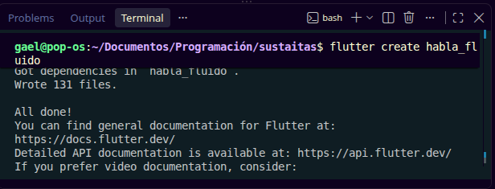
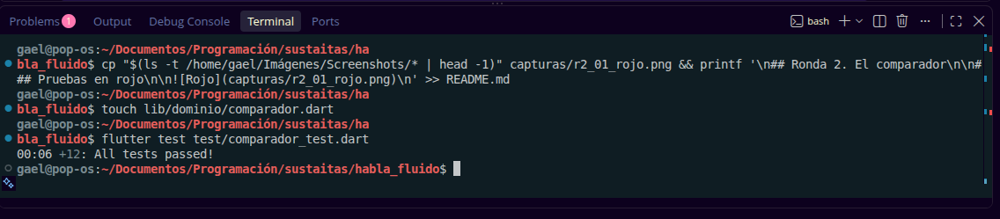
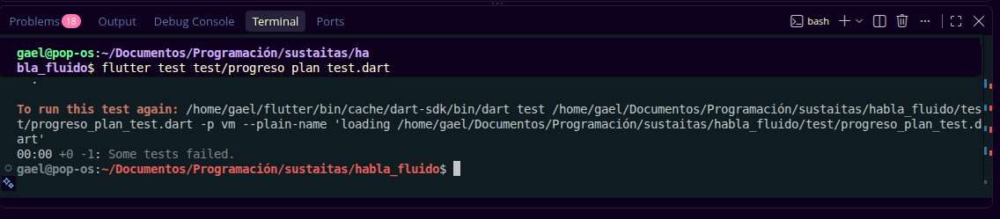
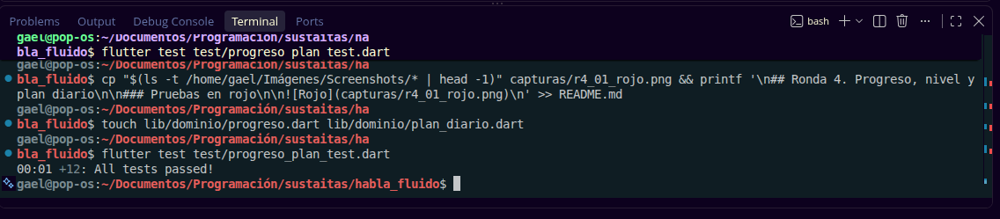
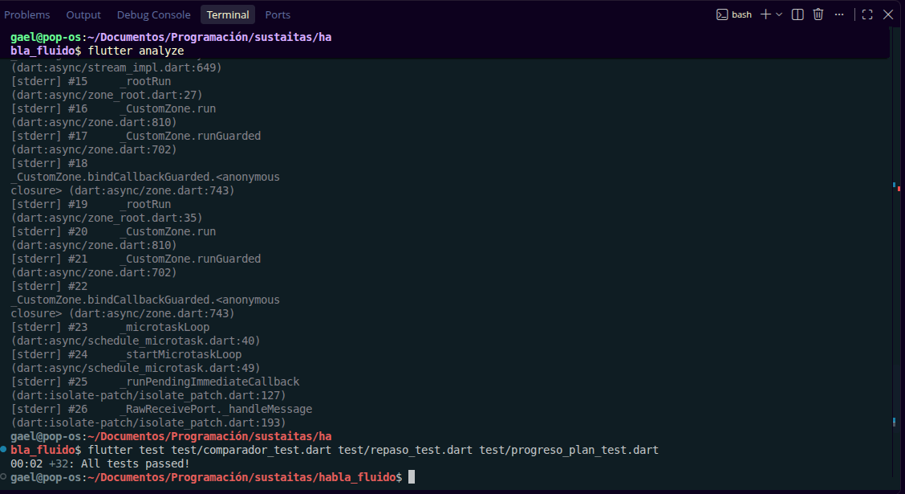
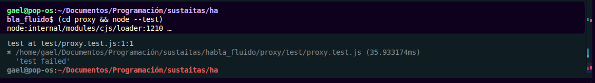

# habla_fluido

A new Flutter project.

## Getting Started

This project is a starting point for a Flutter application.

A few resources to get you started if this is your first Flutter project:

- [Learn Flutter](https://docs.flutter.dev/get-started/learn-flutter)
- [Write your first Flutter app](https://docs.flutter.dev/get-started/codelab)
- [Flutter learning resources](https://docs.flutter.dev/reference/learning-resources)

For help getting started with Flutter development, view the
[online documentation](https://docs.flutter.dev/), which offers tutorials,
samples, guidance on mobile development, and a full API reference.

## Ronda 1. Preparar el proyecto

### Crear el proyecto

### Paquetes instalados

### Permisos de micrófono

### Reglas, niveles y excepciones

## Ronda 2. El comparador

### Pruebas en rojo

### Código en verde

## Ronda 3. Repetición espaciada con SM-2

### Pruebas en rojo

## Ronda 3. Repetición espaciada con SM-2

### Pruebas en rojo

### Código en verde

## Ronda 4. Progreso, nivel y plan diario

### Pruebas en rojo

### Código en verde

## Ronda 5. Contenido, lecturas y el contrato del tutor

## Ronda 6. El proxy del tutor

### Pruebas en rojo

### Código en verde

